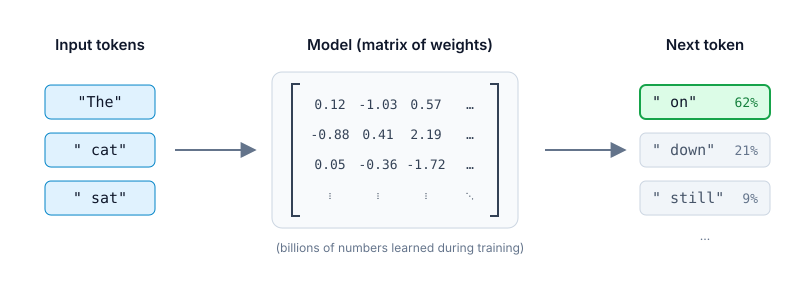
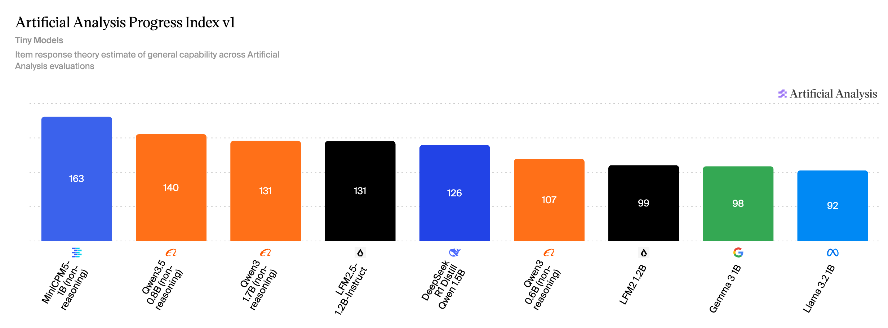

# Vibe-training a small open-weight model to write regular expressions

<iframe aria-describedby="#llm-figure-label" class="border w-full aspect-[4/3]" src="/static/figures/llm-token-prediction.html" loading="lazy"></iframe>
<p id="llm-figure-label" class="mt-2! mb-8! text-center text-xs text-slate-500 italic">An animated language model predicting the next <Term k="token">token</Term>, generated using the <a href="https://april-zhu.com/colorfigures" target="_blank">/colorfigures</a> skill. Click on the "next token" wheel to action it.</p>

> **TL;DR:**
>
> - I <Term k="posttraining">post-trained</Term> Qwen3 (0.6B then 1.7B) to generate JS-flavored regular expressions from natural language
> - Resulting model runs on a playground locally in-browser (1.6GB model download): [https://regex-vibes.netlify.app](https://regex-vibes.netlify.app)
> - Results are mixed: 6 good results out of 10 on simple prompts, 2 out of 10 on harder ones. Still 70% of tests passing on failing prompts. 

As most software engineers nowadays, I use large language models on a daily basis. While I use a Claude subscription at work (and love it!), I keep an eye on <Term k="openweight">open-weights</Term> models that seem to become more and more viable by the weeks. Moreover, specialized small language models seem to give pretty good results when properly trained.      

So I decided to try by myself and I post-trained a a small-sized <Term k="llm">LLM</Term> (actually had Opus 5.5 drive me, hence the "_vibe-training_") to be good at generating JS-flavored regular expression from an english description of what to match, all of it locally in-browser! The result is [this playground](https://regex-vibes.netlify.app).

I learned a lot doing it: here's the process I followed.

## Why regular expressions ?

The goal is pretty simple: give a small language model a description in english of what to match, and get a JS regular expression in return.

```txt
"french phone numbers like 06 12 34 56 78 or 0612345678"
                           ↓
                  /^0[1-9](?: ?\d{2}){4}$/
```

Regular expressions turned out to be a good candidate for a first post-training experiment, for several reasons:

- **narrow scope**: the model only has one thing to be good at
- **short output**: a single line, no explanation needed
- **verifiable output**: we can run the generated regex on a list of strings and know for sure if it's right or not, no need for a human (or another LLM) to judge it
- **useful**: every developer uses them (and nobody likes writing them)

The targeted flavor is ES2018 as executed by Node 22: character classes, quantifiers, lookahead _and_ lookbehind, named groups, `\p{…}`, etc... but not the more recent `v` flag.

And the starting point was not great: before any <Term k="training">training</Term>, the candidate models were giving **~3% of fully correct regular expressions**. Not great indeed.

## What is post-training ?

As most people now know, large language models are basically machine learning models statistically predicting pieces of text (= _tokens_) coming after given pieces of text.



The _<Term k="weights">weights</Term>_, as shown in the schema, are the numerical parameters built into the model (millions to billions of them) adjusted during the _training_ of the <Term k="base">base model</Term> to produce the right output to a given input.

_Post-training_ is the process of nudging these weights after the initial training of a model to steer it into giving answers in a certain style, tone, format, or on a very specific-domain.

## Choosing what model to post-train

There are several factors to take into account when it comes to picking a language model for a given task: the "difficulty" of the task, the performance constraints, the budget, the environment it will run in, etc... 

For my usecase, I identified the following constraints for my model:

### The model must be _open-weight_

It basically means that the weights we talked about in the previous section are public, and that the license of the model allow their reuse.

Here are some useful links to look for these:
- [huggingface.co/models](https://huggingface.co/models): the main hub for open-weight everything
- [Ollama Library](https://ollama.com/library): a library of popular open-weight models
- [xigh/open-weight-models (GitHub repo.)](https://github.com/xigh/open-weight-models): "a curated list of open-weight AI models with commercially exploitable licenses, verified benchmarks, and no geographic restrictions."

### It should have an `Instruct` / `it` variant available

When talking about language models, the distinction must be done between two things:

- _base models_ (or _foundation_ models) that are only trained to guess the next token of a given text)
- _<Term k="instruct">instruct models</Term>_ (or _chat_ models) that are base models already post-trained to answer questions, be helpful to end users, and follow instructions 

Starting from a model that already has _instruct_ capabilities is valuable in our case as we won't need to train the model for it ourselves.

### It should be suitable to be trained on a Macbook Pro with 24Go RAM

Training a machine learning model needs RAM! The reason is that there are several things that need to fit in memory at the same time: the weights of the model to train, training activations, caches, but also other things that are very linked to the method of post-training used:

- Full <Term k="finetuning">Fine-Tuning</Term>: update all of the model's original weights during training. This leads to the best results, but to the cost of really high ressource needs (rule of thumb is 14 to 16 GB of RAM per billion parameters).
- <Term k="lora">Low-Rank Adaptation (LoRA)</Term>: freeze all of the model's original weights and instead train two smaller low-rank matrices of weights (called an _<Term k="adapter">adapter</Term>_). This method is much more memory-efficient (rule of thumb is 2 to 2.5 GB of RAM per billion parameters, see [hf-accelerate/model-memory-usage](https://huggingface.co/spaces/hf-accelerate/model-memory-usage)) and leads to results almost as good (~95% as efficient) as full fine-tuning.

We also need to keep in mind that the model needs to be [compatible with <Term k="mlx">MLX</Term>](https://huggingface.co/models?pipeline_tag=text-generation&library=mlx&sort=downloads), Apple's machine-learning framework (equivalent of PyTorch or JAX, optimized for Apple Silicon chips).

### Final model should be usable in-browser

As we want the resulting model to run on a playground in-browser, we need to validate its compatibilty with [<Term k="transformersjs">Transformers.js</Term>](https://huggingface.co/docs/transformers.js/index) which is the state-of-the-art solution to run machine learning models on web clients.

There are just a quick thing to validate when picking the model: `onnx-community/<model>` should exist on [the HuggingFace hub](https://huggingface.co/models). If an <Term k="onnx">ONNX</Term> version of the base model we want to train exists (which is the format used by Transformers.js), it means that our post-trained model will also be exportable to ONNX in the end, and thus usable in-browser.

The end model should also be small enough to be downloaded and stored by end-users.

### So, what do we pick?

At this point, we still have several candidates matching our needs:

- `Qwen3-0.6B`, `Qwen3.5-0.8B`, `Qwen2.5-Coder-0.5B`: Alibaba's Qwen family, the most popular small open-weight models (the `Coder` variant being specialized in code)
- `Gemma3-1b`, `Gemma3-270m`: Google's family of small open-weight models
- `Llama-3.2-1B`: Meta's smallest text model
- `MiniCPM5-1B`: OpenBMB's small model, specifically designed to run on-device
- `Granite-4.0-350M`: IBM's tiny model
- ... [and more](https://artificialanalysis.ai/models/open-source/tiny)



I first measured all of these candidates _raw_ (with a few examples of expected answers in the prompt, aka _<Term k="fewshot">few-shot</Term>_ prompting) on a set of 400 real-world regex needs gathered from [regex101](https://regex101.com). They all scored between ~3% and 8%: no obvious winner...

| Model              | Raw (few-shot) | 
| ------------------ | -------------- | 
| Gemma3-1B          | 3.3%           | 
| Granite-4.0-350M   | 3.5%           | 
| Llama-3.2-1B       | 5.5%           | 
| Qwen2.5-Coder-0.5B | 5.3%           | 
| MiniCPM5-1B        | 8.0%           | 
| Qwen3-0.6B         | 2.8%           | 
| Qwen3.5-0.8B       | 2.8%           | 
| **Qwen3-1.7B**     | 3.5%           | 

<p class="mt-2! mb-8! text-xs text-slate-500 italic">Fully correct regular expressions on 400 real-world needs (regex101).</p>

After some online researches, it seemed like `Qwen3-0.6B` was one of the most common bases for small-scale post-training: it's strong for its small size, it supports thinking and non-thinking modes, and it fits easily on an average GPU, so it's cheap to iterate on. So I followed the advice and went with `Qwen3-0.6B` to iterate (~1h per training), and `Qwen3-1.7B` for the final version (~2h15). I also disabled Qwen3's _thinking_ mode: for a one-line answer, latency matters more than reasoning.

## Building the training dataset

Now that we have a model to train, we need data to train it on. It is one of the most important parts of the post-training: a _good_ training dataset is what will give you the best results. Let's see what "good" means here:

### General guidelines

#### Quality is worth more that quantity

As stated in [the LIMA paper (Less Is More for Alignment)](https://arxiv.org/abs/2305.11206), for a narrow post-training task made in LoRA on a small <= 1B parameters model, hundreds to a few thousands of training examples are sufficient. 

#### Examples must be verified

As we'll explain further, most of post-training techniques rely on _imitation_, and as models learn as well from mistakes as from good answers, a wrong example is worse than one less example. This is why you want to make sure that your _"input -> output"_ pairs are valid. _How_ to validate is really dependent on the problem you're trying to tackle, but in our case of generating regular expression, this is pretty straightforward:

For each exemple, we just keep two lists of strings next to the description and the expected regex:

```json
{
  "description": 
    "french phone numbers like 06 12 34 56 78 or 0612345678",
  "regex": "/^0[1-9](?: ?\\d{2}){4}$/",
  "should_match": [
    "06 12 34 56 78", 
    "0612345678", 
    "01 23 45 67 89"
  ],
  "should_not_match": [
    "6 12 34 56 78", 
    "00 12 34 56 78", 
    "06-12-34-56-78", 
    "061234567"
  ]
}
```

Then, we can just validate each example as such:

```js
// 1. does the regex compile properly?
const re = new RegExp(source, flags);              
const ok =
  // 2. does it match what it should?
  should_match.every(s => re.test(s)) &&
  // 3. does it not match what it shouldn't?
  should_not_match.every(s => !re.test(s));
```

If one of the three tests fail, the exemple is not kept (or is at least corrected). Only examples that pass all the tests are kept in the dataset.

> **"_`/.*/` matches every `should_match`, right?_"**
>
> Yes, that's right, and that's why `should_not_match` are essential: they avoid training the model to generate regex that are _too_ permissive.

#### Diversity of examples taxonomy

Dataset examples must look like real-world usage.

To drive the generation of examples, we must define a taxonomy of needs that defines the diversity of the cases we want. The end model will be good at what we've trained it to be good at, so the closer our training dataset resemble what the model will get fed in "production", the better it will perform. This taxonomy must make explicit the following things about what to generate:

- the regex concepts to cover: character classes, quantifiers, anchors, groups, alternation, lookahead/lookbehind, backreferences, flags (`i`, `g`, `m`, `u`, `s`), etc... 
- the categories of examples: numbers, money, datetimes, web, phone numbers, logs, text, structured data...
- the difficulties of the examples and their relative proportion in the dataset: simple (30%), medium (50%), hard (20%)
- the "tones" of descriptions:
  - Well-written with a example: _`"Accept a positive whole number (ex: 4567): One or more digits..."+`_
  - Relaxed style + spelling mistake: _`"six pairs of hexadecimal digits sparated by hyphens"`_
  - Terse prompt + mistakes: _`"css length w uint px em rem % vh vw no spaces decimal ok"`_
  - Just one word: _`"email"`_
  - ... 

#### Keep one consistent output format

To be able to propely validate the model's answers, we have to make sure that its output follows a format that is constant and unique: just a JS regular expression literal (`/…/flags`), nothing else. No explanation, no _"Here is the regex:"_, no ```` ```js ```` block around it.

The parsing of the answers is strict on purpose: **a chatty answer is considered malformed, because it can't be compiled as is.** To achieve that, the system prompt (_"write a ES2018 JS regex, only answer with a `/…/flags` literal"_) is defined once and shared everywhere: when generating the dataset, when training, when evaluating, and in the playground.

It might seem like a detail, but it's actually the first thing raw models fail at: before any training, `Qwen3-1.7B` answered in a wrong format 60% of the time (pattern without delimiters, `/…/.test(str)`, text around the regex...). This is also the first thing post-training fixes.

### Generating the dataset with a teacher model

So, where do we find the data from? There's no public dataset of _"description → regex + tests"_ that matches our needs, so we have to generate it ourselves. That's where a bigger model comes in: a _<Term k="teacher">teacher</Term>_ model writes the exercises, and Node sorts them out.

- **1. Taxonomy**: 20 categories, 3 levels of difficulty, several tones of descriptions (see previous section).
- **2. Teacher**: [DeepSeek V4.1 Flash](https://openrouter.ai) writes the descriptions, the regexes and the tests.
- **3. Guardrails**: everything is run in Node, tested, deduplicated...
- **4. Dataset**: only what passes every check is kept.

The guardrails are where most of the work is. A few things that turned out to matter:

- **tests are written in a separate call, without seeing the regex**: otherwise they inherit its bugs
- **at least 5 positive and 5 negative tests**, including at least 3 _"near-miss"_ negatives (one char too many, wrong anchoring, wrong case, out of range value...)
- **trivial or mutated regexes must fail**: `/.*/`, the reference regex without its anchors, with loosened quantifiers or widened character classes must fail at least one test, otherwise the tests are too weak and the example is rejected

<div class="flex justify-around text-center my-8">
  <div><p class="text-xs text-slate-500">Generated needs</p><p class="text-4xl font-bold">27,460</p></div>
  <div><p class="text-xs text-slate-500">Kept examples (36%)</p><p class="text-4xl font-bold">9,819</p></div>
  <div><p class="text-xs text-slate-500">Total cost</p><p class="text-4xl font-bold text-orange-500">$6</p></div>
</div>

Only 36% of the generated needs were kept, and this depends a lot on the category: 9% for `logs` (long lines with nested rules), 61% for `identifiers`.

### Cleaning and splitting

Once we have our examples, we need to split them, and that's an important step: **we never evaluate a model on what it has been trained on.**

- **train** (9348 examples), _the exercises_: what the model studies.
- **<Term k="heldout">held-out</Term>** (471 examples), _the mock exam_: never studied by the model, but generated from the same mold as the train.
- **<Term k="benchmark">benchmarks</Term>** (3 of them), _the real exam_: written by someone else than the teacher. In my case: one written by Claude, one by GPT, and 400 real-world needs from [regex101](https://regex101.com) (based on [this gist](https://raw.githubusercontent.com/innovatorved/regex_dataset/refs/heads/main/data.json), descriptions reworked by GPT 6.1 Sol).

> **Why bother having benchmarks _and_ a held-out?** 
> 
> Because the held-out comes from the same teacher as the train: same style, same wording, same way of interpreting a need. Evaluating only on it would flatter the model, and we'll see later that it actually does, a lot.

## Figure out what post-training method to use

There are a lot of post-training methods, but they can be grouped in three families, depending on _how_ the model learns.

### Learning by imitation

- **Continued pretraining**: keep training the model to predict the next token, but on raw text from a specific domain, to teach it new vocabulary or knowledge.
- **SFT (Supervised Fine-Tuning)**: show the model thousands of _"input → right answer"_ pairs, and train it to reproduce the answers.
- **RFT (Rejection sampling Fine-Tuning)**: make the model generate several answers to a same prompt, keep only the correct ones, and do an SFT on them: the model learns from its own successes.
- **Distillation**: do an SFT on the answers of a bigger model.

### Learning by preferences

- **DPO (Direct Preference Optimization)**: show the model two answers to a same prompt, a _chosen_ one and a _rejected_ one, and train it to prefer the first.
- **KTO**: same idea, but with single answers labelled as good or bad, no need for pairs.

### Learning by trying and being judged

- **Reinforcement learning (RLHF ou RLAIF)**: the model generates answers, and a _reward model_ (trained on human or AI preferences) grades them; the model is pushed towards well-graded answers.
- **GRPO**: the model generates a group of answers for a same prompt, each one gets a reward, and the ones above the group's average are reinforced. It works especially well with a _verifiable_ reward (aka _RLVR_), like... running a regex on tests.

My need was a precise task with a fixed output format, so I went with **SFT**. 

> In practice, SFT almost always comes first, as it puts the model in the right format and on the right domain before any other method can be applied.

## Training with SFT and LoRA

### How SFT works

SFT is the same loop as pre-training (predict → measure → correct → repeat), but on _our_ data. For each example, the prompt and the beginning of the right answer are given to the model, and it must guess the next token:

```txt
[user] french phone numbers…  /^ 0 ?
```

- **1. Predict**: the model gives `\d` at 55%, `6` at 20%, `[1-9]` at 12%...
- **2. Get surprised**: the right answer was `[1-9]`, at 12% only. The <Term k="loss">loss</Term> is high (2.1).
- **3. Correct**: the <Term k="gradient">gradient</Term> adjusts the weights a little bit: `[1-9]` ↑, `\d` ↓.
- **4. Repeat**: next token, next example. Here, 9348 examples, each seen twice.

One important thing: **only the answer is graded**, the prompt is just context. We don't want to teach the model to rewrite the user's description.

### LoRA: a patch rather than a rewrite

As explained earlier, LoRA freezes the original weights `W` of the model, and trains two small matrices `B` and `A` next to them: the output of a layer becomes `W·x + B·A·x`. In our case, with a _rank_ of 16 on the attention and MLP layers of every block, **only 1.7% of the weights are trained**, and the result is an _adapter_ of a few dozen MB.

> To know if a training goes well, we watch the _loss_ on the train set and on a validation set the model doesn't learn from. Here, the validation loss went from 2.45 to 0.164 and was still going down at the end: no <Term k="overfitting">overfitting</Term>.

### From the Mac to the browser

Once the adapter is trained, a few steps remain to get it running in a browser:

- **1. Fuse**: the adapter is merged into the base model weights (made using MLX)
- **2. Export**: to ONNX, _<Term k="quantization">quantized</Term>_ in 4 bits.
- **3. Serve**: with Transformers.js, on <Term k="webgpu">WebGPU</Term>.

For the final model: **2h15 of training, 7.1GB of memory at peak, and 1.43GB once exported.** Yes, that's above the 1GB limit I gave myself earlier. I assumed it: `Qwen3-1.7B` was clearly better in quality, and `Qwen3.5-0.8B`, that would have fit, was way too slow in-browser (for model architecture reasons).

## Measuring the results

### How to evaluate

The evaluation follows the same logic as the dataset validation: for each case, the prompt is given to the model, its answer is parsed as a `/…/flags` literal, and the regex is run in Node on hidden tests.

The main metric is **full success: all the tests pass**. Because in real life, a regex that is 90% right is a wrong regex. We also keep an eye on the rate of passed tests and on malformed answers, to understand _how_ the model fails.

### The numbers

On the held-out:

<div class="flex justify-around text-center my-8">
  <div><p class="text-xs text-slate-500">Qwen3-0.6B raw</p><p class="text-4xl font-bold">2.8%</p></div>
  <div><p class="text-xs text-slate-500">0.6B after SFT</p><p class="text-4xl font-bold">72%</p></div>
  <div><p class="text-xs text-slate-500">1.7B after SFT</p><p class="text-4xl font-bold text-orange-500">77%</p></div>
</div>

From 2.8% to 77% of fully correct regular expressions, that's huge! But the held-out is the mock exam... On requests the model has never seen, it gets **6 out of 10 simple requests right, and only 2 out of 10 harder ones.**

Still, when it fails, ~70% of the tests pass anyway: the regexes are _almost_ right. Which is actually a problem: **an almost right regex is a silent error.**

### Outside the teacher's mold

Here's what happens when we compare the held-out to the benchmarks, by difficulty:

| SFT Qwen3-1.7B | Held-out | Claude benchmark | regex101 benchmark | 
| -------------- | -------- | ---------------- | ------------------ | 
| Simple         | 88%      | 73%              | 46%                | 
| Medium         | 77%      | 38%              | 14%                | 
| Hard           | 57%      | 11%              | 10%                | 

The held-out measures what the model learned **from the teacher**, not how good it is in the real world. Even on simple requests, we lose ~16 points as soon as we leave DeepSeek's distribution. And on real requests (regex101), it's less than one out of two on simple needs...

## Retrospective

### What worked:

- **SFT**: from 2.8% to 77% on the held-out
- **tests as ground truth**: no need for an external judge (human or other LLM), Node is enough
- **the cost**: $6 of data, a Mac, no rented GPU
- **scaling**: going from 0.6 to 1.7 billion parameters gave +5 points
- **in-browser execution**: private, free for every request, <500ms latency

### What didn't:

- **real-world requests**: ~26.5% on average on the regex101 needs
- **model too small**: a model as Qwen3-1.7B might be too small for a production usage on this case
- **silent errors**: almost right regexes, ~70% of tests passing

## Conclusion

Yes, I known, the final numbers are not this good. But to be honnest I did not really expect getting a 100% success. My goal was mainly to learn the basis of post-training, and to make sure of something: a small specialized model can give good results on a narrow task: we might not need a frontier model for everything.

You can try the result by yourself on [the playground](https://regex-vibes.netlify.app) (Chromium with WebGPU only for now).

Hope you learned something!
