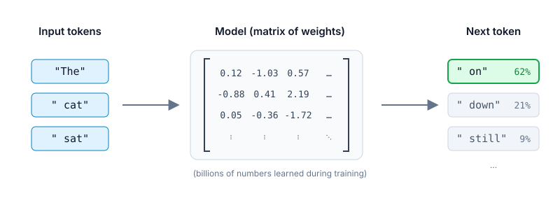

# Post-training a small open-weight model to write regular expressions

<iframe aria-describedby="#llm-figure-label" class="border w-full aspect-[4/3]" src="/static/figures/llm-token-prediction.html" loading="lazy"></iframe>

An animated language model predicting the next token, generated using the <a href="https://april-zhu.com/colorfigures" target="_blank">/colorfigures</a> skill. Click on the "next token" wheel to action it.

> **TL;DR:**
>
> - I post-trained Qwen-3-0.6B to generate JS-flavored regular expressions from natural language
> - Resulting model runs on a playground locally in-browser (1.6GB model download): [https://regex-vibes.netlify.app](https://regex-vibes.netlify.app)
> - Results are mixed: 7 good results out of 10 on simple prompts, 2 out of 10 on harder ones

I went to the [DotAI](https://www.dotai.io) conference in Paris a few weeks ago, and some subjects were recurrent in a lot of talks and discussions:

- we are currently giving our whole lives and companies data to Anthropic and OpenAI
- open-weights models and self-owned inference is becoming more and more viable by the weeks
- post-training seems to be an interesting intersection of the two previous points

So I decided to try by myself and I post-trained a a small-sized LLM to be good at generating JS-flavored regular expression from an english description of what to match.

But as I know _nothing_ about how to do it, I had to make Opus 5.5 (yikes) drive me. Here's what I learned in the process.

## What is post-training ?

As most people now know, large language models are basically machine learning models statistically predicting pieces of text (= _tokens_) coming after given pieces of text.

The _weights_, as shown in the schema, are the numerical parameters built into the model (millions to billions of them) adjusted during the _training_ of the base model to produce the right output to a given input.

_Post-training_ is the process of nudging these weights after the initial training of a model to steer it into giving answers in a certain style, tone, format, or on a very specific-domain.

## Choosing what model to post-train

There are several factors to take into account when it comes to picking a language model for a given task: the "difficulty" of the task, the performance constraints, the budget, the environment it will run in, etc... 

Given our usecase, we can identify the following constraints for our model:

### 1. The model must be _open-weight_

It basically means that the weights we talked about in the previous section are public, and that the license of the model allow their reuse.

Here are some useful links to look for these:
- [huggingface.co/models](https://huggingface.co/models): the main hub for open-weight everything
- [Ollama Library](https://ollama.com/library): a library of popular open-weight models
- [xigh/open-weight-models (GitHub repo.)](https://github.com/xigh/open-weight-models): "a curated list of open-weight AI models with commercially exploitable licenses, verified benchmarks, and no geographic restrictions."

### 2. It should have an `Instruct` / `it` variant available

When talking about language models, we must do the distinction between two things:
- _base models_ (or _foundation_ models) that are only trained to guess the next token of a given text)
- _instruct models_ (or _chat_ models) that are base models already post-trained to answer questions, be helpful to end users, and follow instructions 

Starting from a model that already has _instruct_ capabilities is valuable in our case as we won't need to train the model for it ourselves.

### 3. It should be suitable to be trained on a Macbook Pro with 24Go RAM

Training a machine learning model needs RAM! The reason is that there are several things that need to fit in memory at the same time: the weights of the model to train, training activations, caches, but also other things that are very linked to the method of post-training used:

- Full Fine-Tuning: update all of the model's original weights during training. This leads to the best results, but to the cost of really high ressource needs (rule of thumb is 14 to 16 GB of RAM per billion parameters).
- Low-Rank Adaptation (LoRA): freeze all of the model's original weights and instead train two smaller low-rank matrices of weights (called an _adapter_). This method is much more memory-efficient (rule of thumb is 2 to 2.5 GB of RAM per billion parameters, see [hf-accelerate/model-memory-usage](https://huggingface.co/spaces/hf-accelerate/model-memory-usage)) and leads to results almost as good (~95% as efficient) as full fine-tuning.

We also need to keep in mind that the model needs to be [compatible with MLX](https://huggingface.co/models?pipeline_tag=text-generation&library=mlx&sort=downloads), Apple's machine-learning framework (equivalent of PyTorch or JAX, optimized for Apple Silicon chips).

### 4. Final model should be usable through transformers.js in-browser (< 1.5Go)

## Building the training dataset

- what is valuable for a good training
- where to find the data from
- difference between "train", "held-out" and "benchmark"

## Figure out what post-training method to use

### Learning by imitation

- Continued pretraining:
- SFT (Supervised Fine-Tuning):
- RFT:
- Distillation:

### Learning by preferences

- DPO:
- KTO:

### Learning by trying and being judged

- Reinforcement learning (RLHF ou RLAIF):
- GRPO:

### How to apply the post-training

- **Full fine-tuning:**
- **LoRA:**
- **QLoRA:**

### The right method based on the need

| Need                                                 | Recommended pipeline                                             |
| ---------------------------------------------------- | ---------------------------------------------------------------- |
| Often-changing knowledge base                        | No post-training: RAG. Fine-tuning doesn't handle new facts well |
| Specific domain or vocabulary                        | Continued pretraining then SFT                                   |
| Specific output format, tone, style, or precise task | SFT + LoRA                                                       |
| Reduce unwanted answer, improve model "UX"           | DPO, or KTO                                                      |
| Reasoning, maths/code, _tool use_, _agents_          | GRPO (RLVR)                                                      |
| Make a small model better at reasoning               | Distillation from a bigger LLM                                   |
