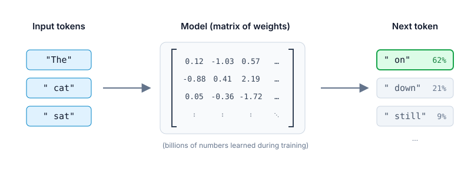
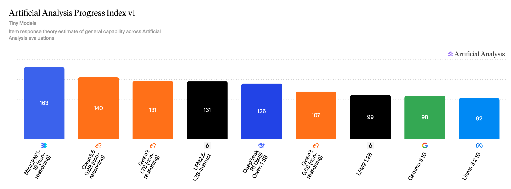

# Vibe-training a small open-weight model to write regular expressions

<iframe aria-describedby="llm-figure-label" class="border w-full aspect-[4/3]" src="/static/figures/llm-token-prediction.html" loading="lazy"></iframe>
<p id="llm-figure-label" class="mt-2! mb-8! text-center text-xs text-slate-500 italic">An animated language model predicting the next <Term k="token">token</Term>, generated using the <a href="https://april-zhu.com/colorfigures" target="_blank">/colorfigures</a> skill.</p>

> **TL;DR:**
>
> - I <Term k="posttraining">post-trained</Term> Qwen3 (0.6B then 1.7B) to generate JS-flavored regular expressions from English descriptions.
> - Resulting model runs on a playground locally in-browser (1.43GB model download): [https://regex-vibes.netlify.app](https://regex-vibes.netlify.app)
> - Results are mixed: ~60% of good results (=regex passing 100% of tests) on simple prompts, ~20% on medium ones, ~10% on difficult ones. Still, failing regexes pass ~70% of their tests.
> - I made this experiment for learning purposes. **I wouldn't recommend using the resulting model for production needs.**

Like most software engineers nowadays, I use large language models on a daily basis. While I have a Claude subscription at work (and love it!), I keep an eye on <Term k="openweight">open-weight</Term> models that seem to become more and more viable by the week. Moreover, specialized small language models seem to give pretty good results when properly trained.      

So I decided to try by myself and I post-trained a small-sized <Term k="llm">LLM</Term> (actually had Opus 5.5 drive me, hence the "_vibe-training_") to be good at generating JS-flavored regular expressions from an English description of what to match. **The resulting model runs in [this playground](https://regex-vibes.netlify.app) locally in your browser.**

I learned a lot doing it: here's the process I followed.

## Why regular expressions?

The goal is pretty simple: give a small language model a description in English of what to match, and get a JS regular expression in return.

<div class="border py-8 my-8 flex flex-col items-center gap-2 text-center">
  <p class="m-0! text-xs text-slate-500 uppercase tracking-wide">Plain English</p>
  <p class="m-0! border px-4 py-2 italic">"french phone numbers like 06 12 34 56 78 or 0612345678"</p>
  <p class="m-0! text-2xl text-orange-500" aria-hidden="true">↓</p>
  <p class="m-0! text-xs text-slate-500 uppercase tracking-wide">JS regular expression</p>
  <p class="m-0! border border-orange-500 px-4 py-2 font-mono font-bold">/^0[1-9](?: ?\d{2}){4}$/</p>
</div>

It turns out regular expressions are a good candidate for a first post-training experiment, for several reasons:

- **narrow scope**: the model only has one thing to be good at
- **short output**: a single line, no explanation needed
- **verifiable output**: we can run the generated regex on a list of strings and know for sure if it's right or not, no need for a human (or another LLM) to judge it
- **useful**: every developer uses them (and nobody likes writing them)

> The targeted flavor is ES2018 as executed by Node 22: character classes, quantifiers, lookahead _and_ lookbehind, named groups, `\p{…}`, etc. (not the more recent `v` flag)

The starting point was not great: before any <Term k="training">training</Term>, the candidate models were giving **less than 8% of fully correct regular expressions**.

## What is post-training?

Large language models are basically machine learning models statistically predicting pieces of text (= tokens) coming after _given_ pieces of text.


<p class="mt-2! mb-8! text-center text-xs text-slate-500 italic">Simplified diagram of the wieghts matrix that make up an LLM.</p>

The <Term k="weights">weights</Term>, as shown in the schema, are the numerical parameters built into the model (millions to _trillions_ of them) adjusted during the training of the <Term k="base">base model</Term> to produce the right output to a given input.

**Post-training is the process of nudging these weights** after the initial training of a model to steer it into giving answers in a certain style, tone, format, or on a very specific domain.

## Choosing what model to post-train

There are several factors to take into account when it comes to picking a language model for a given task: the "difficulty" of the task, the performance constraints, the budget, the environment it will run in, etc.

For my use case, I identified the following constraints that the model I would train should respect:

### The model must be open-weight

It basically means that the weights we talked about in the previous section are public, and that the license of the model allows their reuse.

Here are some useful links to look for these:
- [**huggingface.co/models**](https://huggingface.co/models): the main hub for open-weight everything
- [**Ollama Library**](https://ollama.com/library): a library of popular open-weight models
- [**xigh/open-weight-models (GitHub repo.)**](https://github.com/xigh/open-weight-models): "a curated list of open-weight AI models with commercially exploitable licenses, verified benchmarks, and no geographic restrictions."

### It should have an `Instruct` / `it` variant available

When talking about language models, a distinction must be made between two things:

- **_base models_** (or _foundation_ models) that are only trained to guess the next token of a given text
- **_<Term k="instruct">instruct models</Term>_** (or _chat_ models) that are base models already post-trained to answer questions, be helpful to end users, and follow instructions 

Starting from a model that already has _instruct_ capabilities was valuable in my case as I wouldn't need to train the model for it myself.

### It should be suitable to be trained on a MacBook Pro with 24GB RAM

Training an ML model needs RAM! The reason is that there are several things that need to fit in memory at the same time: the weights of the model to train, training activations, caches, etc. But above all, **the quantity of RAM needed is mostly tied to the post-training method used**:

- **Full <Term k="finetuning">Fine-Tuning</Term>**: update all of the model's original weights during training. This leads to the best results, but at the cost of really high resource needs (rule of thumb is 14 to 16 GB of RAM per billion parameters).
- **<Term k="lora">Low-Rank Adaptation (LoRA)</Term>**: freeze all of the model's original weights and instead train two smaller low-rank matrices of weights (called an _<Term k="adapter">adapter</Term>_). This method is much more memory-efficient (**rule of thumb is [3 to 4 GB of RAM per billion parameters](https://huggingface.co/spaces/hf-accelerate/model-memory-usage)**) and [leads to results almost as good as full fine-tuning](https://thinkingmachines.ai/blog/lora).

I also needed to keep in mind that the model needs to be [compatible with <Term k="mlx">MLX</Term>](https://huggingface.co/models?pipeline_tag=text-generation&library=mlx&sort=downloads), Apple's machine-learning framework (equivalent of PyTorch or JAX, optimized for Apple Silicon chips).

### Final model should be usable in-browser

As I wanted the resulting model to run on a playground in-browser, I needed to **validate its compatibility with [<Term k="transformersjs">Transformers.js</Term>](https://huggingface.co/docs/transformers.js/index)** which is the state-of-the-art solution to run machine learning models on web clients.

There's just a quick thing to validate when picking the model: `onnx-community/<model>` should exist on [the HuggingFace hub](https://huggingface.co/models). If an <Term k="onnx">ONNX</Term> version of the base model to train exists (which is the format used by Transformers.js), it means that the post-trained model will also be exportable to ONNX in the end, and thus usable in-browser.

**The end model should also be small enough to be downloaded and stored by end-users**. My hard limit on this was ~1.5GB (which is already a lot!).

### So, what do we pick?

At this point, I still had several candidates matching my needs:

- `Qwen3-0.6B/1.7B`, `Qwen3.5-0.8B`, `Qwen2.5-Coder-0.5B`: Alibaba's Qwen family, the most popular small open-weight models (the `Coder` variant being specialized in code)
- `Gemma3-1b`, `Gemma3-270m`: Google's family of small open-weight models
- `Llama-3.2-1B`: Meta's smallest text model
- `Granite-4.0-350M`: IBM's tiny model
- ... [and more](https://artificialanalysis.ai/models/open-source/tiny)



I first measured all of these candidates _raw_ (with a few examples of expected answers in the prompt, aka _<Term k="fewshot">few-shot</Term>_ prompting) on two sets: the held-out set (more on it later) and a set of 400 real-world regex needs gathered from [regex101](https://regex101.com). **They all scored between ~1% and 8%: no obvious winner...**

| Model              | Held-out (few-shot) | regex101 (few-shot) |
| ------------------ | ------------------- | ------------------- |
| Gemma3-1B          | 1.4%                | 3.3%                |
| Granite-4.0-350M   | 2.9%                | 3.5%                |
| Llama-3.2-1B       | 4.8%                | 5.5%                |
| Qwen2.5-Coder-0.5B | 5.9%                | 5.3%                |
| Qwen3-0.6B         | 2.3%                | 2.8%                |
| Qwen3.5-0.8B       | 4.8%                | 2.8%                |
| **Qwen3-1.7B**     | **5.0%**            | **3.5%**            |

<p class="mt-2! mb-8! text-xs text-slate-500 italic">Fully correct regular expressions before any training, on the held-out set and on 400 real-world needs (regex101).</p>

After some online research, it seemed like `Qwen3-0.6B` was one of the most common bases for small-scale post-training: it's strong for its small size, it supports thinking and non-thinking modes, and it fits easily on an average GPU, so it's cheap to iterate on. So I followed the advice and **went with `Qwen3-0.6B` to iterate (~1h per training), and `Qwen3-1.7B` for the final version (~2h15)**, both with _thinking_ disabled: for a one-line answer, latency matters more than reasoning.

## Building the training dataset

Now that I had a model to train, I needed data to train it on. It is one of the most important parts of post-training: a good training dataset is one of the keys to good results. Let's see what I mean here:

### General guidelines

#### Quality is worth more than quantity

For a narrow post-training task done with LoRA on a small (~1B parameters) model, **hundreds to a few thousands of training examples are sufficient**. A few references going in that direction:

- [OpenAI's supervised fine-tuning guide](https://developers.openai.com/api/docs/guides/supervised-fine-tuning#right-number-of-examples) reports improvements from fine-tuning on 50 to 100 examples, and recommends starting with 50 and evaluating before adding more.
- [AlpaGasus (Chen et al., ICLR 2024)](https://arxiv.org/abs/2307.08701): keeping only the 9k best-rated examples of the 52k Alpaca dataset gives a better model than training on all of it.
- My own runs: with only 2k examples, `Qwen3-0.6B` already reached 56.6% on the held-out, against 71.7% with the full 9k. **Most of the gain comes from the first thousands of examples, even if more data still helps.**

#### Examples must be verified

As explained further, most post-training techniques rely on imitation, and as **models imitate mistakes just as faithfully as good answers**, a wrong example is worse than one less example. This is why I wanted to make sure that my _"input -> output"_ pairs were valid. _How_ to validate is really dependent on the problem you're trying to tackle, but in my case of generating regular expressions, this is pretty straightforward:

For each example, **I just kept two lists of strings next to the description and the expected regex: `should_match` and `should_not_match`**

```json
{
  "description": 
    "french phone numbers like 06 12 34 56 78 or 0612345678",
  "regex": "/^0[1-9](?: ?\\d{2}){4}$/",
  "should_match": [
    "06 12 34 56 78", 
    "0612345678", 
    "01 23 45 67 89"
  ],
  "should_not_match": [
    "6 12 34 56 78", 
    "00 12 34 56 78", 
    "06-12-34-56-78", 
    "061234567"
  ]
}
```

`should_match` is a list of strings the regex must match and `should_not_match` is a list of strings the regex must reject. Both are required for the regex to be considered valid: as `/.*/` matches every `should_match` string possibly existing, **`should_not_match` ensures that generated regexes are not _too_ permissive**.

Then, each example can be validated as such (ofc oversimplified code):

```js
// 1. does the regex compile properly?
const re = new RegExp(source, flags);              
const ok =
  // 2. does it match what it should?
  should_match.every(s => re.test(s)) &&
  // 3. does it not match what it shouldn't?
  should_not_match.every(s => !re.test(s));
```

If one of the three tests fails, the example is not kept. **Only examples that pass all the tests are kept in the dataset.**

#### Diversity of examples taxonomy

**Dataset examples _must_ look like real-world usage**. To drive the generation of examples, we must define a taxonomy of needs that defines the diversity of the cases we want. The end model will be good at the type of examples it saw during training, so the closer the training dataset resembles what the model will get fed in "production", the better it will perform. 

This taxonomy must make explicit the following things about what to generate:

- **the regex concepts to cover**: character classes, quantifiers, anchors, groups, alternation, lookahead/lookbehind, backreferences, flags (`i`, `g`, `m`, `u`, `s`), etc.
- **the categories of examples**: numbers, money, datetimes, web, phone numbers, logs, text, structured data...
- **the difficulties of the examples and their relative proportion in the dataset**: simple (30%), medium (50%), hard (20%)
- **the "tones" of descriptions**:
  - Well-written with an example: _`"Accept a positive whole number (ex: 4567): One or more digits..."`_
  - Relaxed style + spelling mistake: _`"six pairs of hexadecimal digits sparated by hyphens"`_
  - Terse prompt + mistakes: _`"css length w uint px em rem % vh vw no spaces decimal ok"`_
  - Just one word: _`"email"`_
  - ... 

#### Keep one consistent output format

To be able to properly validate the model's answers, we have to make sure that its **output follows a format that is constant and unique: just a JS regular expression literal (`/…/flags`), nothing else**. No explanation, no _"Here is the regex:"_, no ```` ```js ```` block around it.

The parsing of the answers is strict on purpose: a chatty answer is considered malformed, because it can't be compiled as is in Node and therefore can't be validated. To achieve that, **the system prompt ([something like "write an ES2018 JS regex, only answer with a `/…/flags` literal"_](https://github.com/mdubourg001/regex-generator-local-post-training/blob/regex-generation/scripts/common.py#L20-L24)) is defined once and shared everywhere**: when generating the dataset, when training, when evaluating, and in the playground.

It might seem like a detail, but it's actually the first thing raw models fail at: before any training, `Qwen3-1.7B` answered in a wrong format 60% of the time (pattern without delimiters, `/…/.test(str)`, text around the regex...). This is also the first thing post-training fixes: after SFT, malformed answers drop to 1.8% on the held-out (7.5% on regex101).

### Generating the dataset with a teacher model

There's no public dataset of _"description → regex + tests"_ that matches my needs, so I had to generate it myself. That's where a bigger model comes in: **a _<Term k="teacher">teacher</Term>_ model writes the exercises, and Node.js validates them**.

- **1. Teacher generation**: given the taxonomy, [DeepSeek V4.1 Flash](https://openrouter.ai/deepseek/deepseek-v4.1-flash) writes the descriptions, the regexes and the tests.
- **2. Guardrails**: the regex is compiled in Node.js, tests are run, examples are deduplicated...
- **3. Inclusion into dataset**: example is kept only if every check passes.

The guardrails are where most of the work is. A few things that turned out to matter:

- **tests are written in a separate call, without seeing the regex**: otherwise they inherit its bugs
- **at least 5 positive and 5 negative tests**, including at least 3 _"near-miss"_ negatives (one char too many, wrong anchoring, wrong case, out of range value...)
- **trivial or mutated regexes must fail**: `/.*/`, the reference regex without its anchors, with loosened quantifiers or widened character classes must fail at least one test, otherwise the tests are too weak and the example is rejected

Here are the stats of generating the dataset with DeepSeek V4.1 Flash:

<div class="flex justify-around text-center my-8">
  <div><p class="text-xs text-slate-500">Generated needs</p><p class="text-4xl font-bold">27,460</p></div>
  <div><p class="text-xs text-slate-500">Kept examples (36%)</p><p class="text-4xl font-bold">9,819</p></div>
  <div><p class="text-xs text-slate-500">Total cost</p><p class="text-4xl font-bold text-orange-500">$6</p></div>
</div>

**Only 36% of the generated needs were kept** (guardrails _really_ matter!), and this depends a lot on the category: 9% for `logs` (long lines with nested rules), 61% for `identifiers`.

### Cleaning and splitting

Once I had my examples, I needed to split them, and that's an important step: **we never evaluate a model on what it has been trained on.**

- **train** (9348 examples), _the exercises_: what the model studies.
- **<Term k="heldout">held-out</Term>** (471 examples), _the mock exam_: never studied by the model, but generated from the same mold as the train.
- **<Term k="benchmark">benchmarks</Term>** (3 of them), _the real exam_: written by someone other than the teacher. In my case: one written by Claude, one by GPT, and 400 real-world needs from [regex101](https://regex101.com) (based on [this JSON dataset](https://raw.githubusercontent.com/innovatorved/regex_dataset/refs/heads/main/data.json), descriptions reworked and tests written by GPT 6.1 Sol).

> **Why bother having benchmarks _and_ a held-out?** 
> 
> Because the held-out comes from the same teacher as the train: same style, same wording, same way of understanding a need. Evaluating only on it would flatter the model, and we'll see later that it actually does, a lot.

## Choosing a post-training method

There are a lot of post-training methods, but they can be grouped in three families, depending on _how_ the model learns.

- **Learning by imitation**: <Term k="continuedpretraining">Continued pretraining</Term>, <Term k="sft">SFT (Supervised Fine-Tuning)</Term>, <Term k="rft">RFT (Rejection sampling Fine-Tuning)</Term>, <Term k="distillation">Distillation</Term>, ...
- **Learning by preferences**: <Term k="dpo">DPO (Direct Preference Optimization)</Term>, <Term k="kto">KTO</Term>, ...
- **Learning by trying and being judged**: <Term k="rlhf">Reinforcement learning (RLHF or RLAIF)</Term>, <Term k="grpo">GRPO</Term>, ...

**My need was a precise task with a fixed output format, so I went with <Term k="sft">SFT</Term>**. Strictly speaking, since every answer in the training dataset was written by DeepSeek, it's actually also a form of <Term k="distillation">distillation</Term>.

> In practice, SFT almost always comes first when doing post-training, as it puts the model in the right format and on the right domain before any other method can be applied.

## Training with SFT and LoRA

### How SFT works

SFT is the same loop as pre-training (predict → measure → correct → repeat), but on _my_ data. For each example, the prompt and the beginning of the right answer are given to the model, and it must guess the next token:

<div class="border py-8 my-8 flex flex-col items-center gap-2 text-center">
  <p class="m-0! text-xs text-slate-500 uppercase tracking-wide">Prompt (context, not graded)</p>
  <p class="m-0! border px-4 py-2 italic">"french phone numbers like 06 12 34 56 78 or 0612345678"</p>
  <p class="m-0! text-xs text-slate-500 uppercase tracking-wide mt-2!">Beginning of the right answer</p>
  <p class="m-0! border px-4 py-2 font-mono">/^0<span class="text-orange-500">▯</span></p>
  <p class="m-0! text-2xl text-orange-500" aria-hidden="true">↓</p>
  <p class="m-0! text-xs text-slate-500 uppercase tracking-wide">Model's guesses for ▯</p>
  <div class="flex flex-wrap justify-center gap-2 font-mono">
    <p class="m-0! border px-3 py-1">\d <span class="text-slate-500">55%</span></p>
    <p class="m-0! border px-3 py-1">6 <span class="text-slate-500">20%</span></p>
    <p class="m-0! border border-orange-500 px-3 py-1 font-bold">[1-9] <span class="text-orange-500">12% ✓</span></p>
    <p class="m-0! border px-3 py-1">… </p>
  </div>
</div>

- **1. Predict**: the model gives `\d` at 55%, `6` at 20%, `[1-9]` at 12%...
- **2. [Surprisal](https://en.wikipedia.org/wiki/Prediction_in_language_comprehension#Surprisal_theory) calculation**: the right answer was `[1-9]`, at 12% only. The <Term k="loss">loss</Term>, which is the surprisal of the right answer (−ln 0.12), is high (≈ 2.1).
- **3. Correct**: the <Term k="gradient">gradient</Term> adjusts the weights a little bit: `[1-9]` ↑, `\d` ↓ based on the loss.
- **4. Repeat**: next token, next example. Here, 9348 examples over 2 <Term k="epoch">epochs</Term> (every example is seen twice).

> **Only the answer is graded**, the prompt is just context. We don't want to teach the model to rewrite the user's description.

### LoRA: train a small patch rather than the whole model

As explained earlier, LoRA freezes the original weights `W` of the model, and trains two small matrices `B` and `A` next to them: the output of a layer becomes `W * x + B * A * x`. 

In my case, with a <Term k="rank">_rank_</Term> of 16 on the attention and MLP layers of every block, **only ~1% of the base model weights are trained**, and the result is an <Term k="adapter">adapter</Term> of a few dozen MB.

### From the Mac to the browser

Once the adapter is trained, a few steps remain to get it running in a browser:

- **1. Fuse**: the adapter is merged into the base model weights (made using MLX)
- **2. Export to ONNX**, <Term k="quantization">quantized</Term> in 4 bits: each weight is stored on 4 bits instead of 16 for the unquantized model, which allows a lighter and faster model at the cost of some accuracy
- **3. Serve**: with Transformers.js, on <Term k="webgpu">WebGPU</Term>.

For the final model: **2h15 of training, 7.1GB of memory at peak, and 1.43GB once exported.** Yes, that's right at the edge of the ~1.5GB limit I gave myself at the beginning, but I still went with `Qwen3-1.7B` because it was clearly better in quality, and `Qwen3.5-0.8B`, which would have fit and was almost as good for almost half the size, was way too slow in-browser (>5s latency, [most probably for model architecture reasons](https://github.com/kizuna-ai-lab/sokuji/issues/306). It's still available on [the playground](https://regex-vibes.netlify.app/?model=sft-qwen3.5-0.8b) as second choice if you want to try it).

## Measuring the results

### How to evaluate

The evaluation follows the same logic as the dataset validation: for each case, the prompt is given to the model, its answer is parsed as a `/…/flags` literal, and the regex is run in Node.js on hidden tests.

The main metric is **full success: all the tests must pass for a regex to be considered valid**. Because in real life, a regex that is 90% right is a wrong regex. I also kept an eye on the rate of passed tests and on malformed answers, to understand _how_ the model fails.

### The numbers

On the held-out:

<div class="flex justify-around text-center my-8">
  <div><p class="text-xs text-slate-500">Qwen3-1.7B raw (few-shot)</p><p class="text-4xl font-bold">5.0%</p></div>
  <div><p class="text-xs text-slate-500">0.6B after SFT</p><p class="text-4xl font-bold">72%</p></div>
  <div><p class="text-xs text-slate-500">1.7B after SFT</p><p class="text-4xl font-bold text-orange-500">77%</p></div>
</div>

From 5.0% to 77% of fully correct regular expressions, that's huge! But the held-out is the mock exam... On requests the model has never seen, it gets **6 out of 10 simple requests right, and only 1 out of 10 harder ones...**

Still, when it fails, ~70% of the tests pass anyway: the regexes are _almost_ right. Which is actually a problem: **an almost right regex is a silent error that can break in production.**

### Outside the teacher's mold

Here's what happens when comparing the held-out to the benchmarks, by difficulty:

| SFT Qwen3-1.7B | Held-out | Claude benchmark | regex101 benchmark | 
| -------------- | -------- | ---------------- | ------------------ | 
| Simple         | 88%      | 73%              | 46%                | 
| Medium         | 77%      | 38%              | 14%                | 
| Hard           | 57%      | 11%              | 10%                | 

The held-out measures what the model learned **from the teacher**, not how good it is in the real world. Even on simple requests, the model loses ~15% of good results as soon as it leaves DeepSeek's distribution...

For reference, Claude Opus 5.5 (reasoning, medium effort) scores 100% on every one of these benchmarks: the tests are not ambiguous, the gap really comes from the model.

## Retrospective

### What worked

- **SFT**: from 5.0% to 77% on the held-out
- **tests as ground truth**: no need for an external judge (human or other LLM), Node is enough
- **the cost**: $6 of data, a Mac, no rented GPU
- **scaling**: going from 0.6 to 1.7 billion parameters gave +5 points
- **in-browser execution**: private, free for every request, <500ms latency

### What didn't

- **real-world requests**: ~23% on average on the regex101 needs
- **model too small**: a model like Qwen3-1.7B might be too small for production use in this case
- **silent errors**: almost right regexes, ~70% of tests passing
- **<Term k="grpo">GRPO</Term> on top of SFT**: I tried reinforcement learning on `Qwen3-0.6B`, rewarding each answer by the share of tests it passes. It made the model more reliable (malformed answers down from 7.1% to 4.8% on the Claude benchmark, +3 to 4 points of passed tests) but barely more correct: +3.8% of full success, not statistically significant, and nothing on the held-out. 

## Conclusion

Yes, I know, the final numbers are not that good. But to be honest I did not really expect to get 100% success. My goal was mainly to learn the basics of post-training, and to make sure of something: **a small specialized model can give decent results on a narrow task**. And as shown by the results, the format and specificities of a teacher model can be learned very well from a few thousand examples.

You can try the result by yourself on [the playground](https://regex-vibes.netlify.app) (Chromium with WebGPU only for now).

Hope you learned something!

> **Want to reproduce it?**
>
> - Playground: [https://regex-vibes.netlify.app](https://regex-vibes.netlify.app)
> - Code, dataset scripts and training configs: [mdubourg001/regex-generator-local-post-training (GitHub)](https://github.com/mdubourg001/regex-generator-local-post-training). **Beware, everything is raw, uncleaned, and written in French 🇫🇷.**
> - Final model (ONNX, 4 bits): [maximedubourg/regex-sft-qwen3-1.7b-onnx (Hugging Face)](https://huggingface.co/maximedubourg/regex-sft-qwen3-1.7b-onnx)
